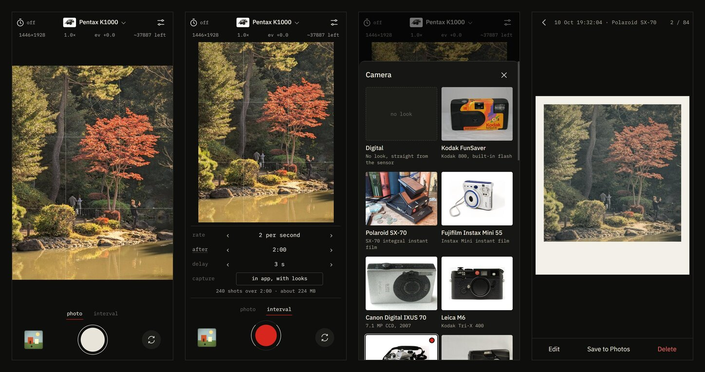
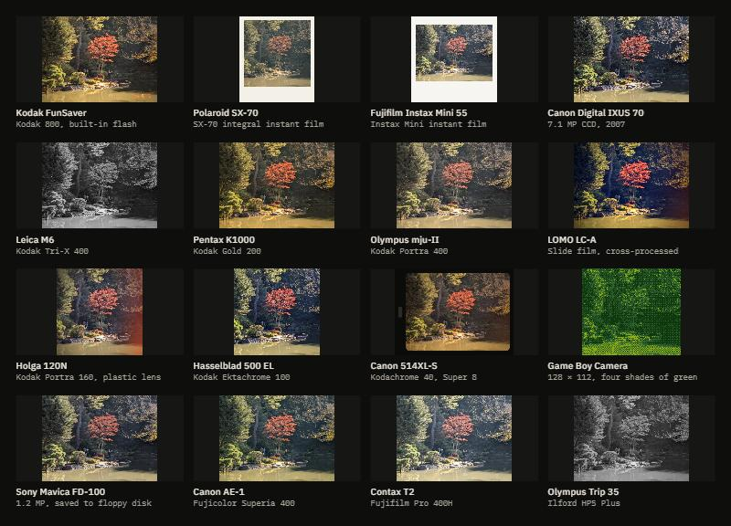

# Darkslide

A camera for iPhone that runs in Safari, built around interval shooting. Prop the phone up, set it to take 2 photos a second for 10 minutes, and walk into the frame. It also has 16 film camera looks, a gallery where you can edit and re-grade shots, and a save button that puts photos straight into your camera roll.

It's a web page, so there's nothing to install from the App Store and no developer account. Add it to your home screen and it opens full screen like any other app.

**Open it:** [shreywy.github.io/darkslide](https://shreywy.github.io/darkslide/)



## Install on iPhone

1. Open [shreywy.github.io/darkslide](https://shreywy.github.io/darkslide/) in Safari.
2. Tap the share button, then **Add to Home Screen**.
3. Open Darkslide from your home screen and allow camera access.

After the first load it works offline. Photos are stored on your phone only. Nothing gets uploaded anywhere.

## Interval shooting

Switch to **interval** under the viewfinder. You set three things:

- rate: from 10 photos a second down to one every 10 minutes
- stop: after a time (10 s to 8 h), after a number of shots, or when you tap stop
- delay: up to a minute before the first shot, so you can get into the frame

The line under the settings tells you how many shots you'll get and how much space they'll take. During a run the screen stays on, the counter shows shots taken and time left, and **dim screen** blacks out the display to save battery while it keeps shooting.

Shots are scheduled against the clock, not chained one after another. If the phone can't keep up (4K at 10 a second, say), it skips that slot and counts it as missed, so a 10 minute run still ends at 10 minutes. Each run is saved as its own roll in the gallery.

Keep the app open for the whole run. iOS stops the camera when you switch apps or lock the phone. If that happens, the run carries on when you come back and the gap shows up as missed shots.

## Full-quality intervals with Shortcuts

Safari only gives web pages the camera's video feed, not the iPhone's photo pipeline (more on that below). If you want full-resolution photos with Apple's processing and don't need more than one shot a second, Darkslide can hand the run to the Shortcuts app instead. Set **capture** to *full quality, via Shortcuts* and the shutter button opens a shortcut with your interval settings. Photos go straight into your camera roll. You can bring them back into Darkslide with **Import** to add a look.

You build the shortcut once. In the Shortcuts app:

1. Tap **+** and name the shortcut exactly `Darkslide Interval`.
2. Add **Get Dictionary from Input** and set its input to *Shortcut Input*.
3. Add **Get Dictionary Value**: get *Value* for key `delay` in *Dictionary*.
4. Add **Wait** and set the seconds to *Dictionary Value*.
5. Add **Get Dictionary Value**: get *Value* for key `count` in *Dictionary*.
6. Add **Repeat** and set the count to that *Dictionary Value*. Put the next steps inside the repeat block:
   1. **Take Photo**. Expand it, choose the back camera and turn off *Show Camera Preview*.
   2. **Save to Photo Album**, album *Recents*.
   3. **Get Dictionary Value**: get *Value* for key `every` in *Dictionary*.
   4. **Wait**, seconds set to that *Dictionary Value*.
7. Run it once from inside Shortcuts so it asks for camera and Photos access.

If Shortcuts adds a *Receive input* line at the top, set it to accept text.

Darkslide sends `{"every": 5, "count": 120, "delay": 3}` (seconds and shots). The shortcut waits after each photo, and taking the photo takes a moment, so the real spacing is a bit longer than the number you pick. Shortcuts doesn't keep the screen awake, so set Auto-Lock to Never for long runs.

## Camera looks



Tap the camera name at the top of the viewfinder to pick one from the list. Tap the star on a camera to pin it, and pinned cameras stay at the top of the list, in the editor and in bulk restyling. The viewfinder shows the look live, grain included, which moves frame to frame like real film. Each camera sets the color, contrast, softness and grain of the film or sensor it copies, and some change the format too: the SX-70 and Instax print with their white borders, the Super 8 frame has rounded gate corners, the Holga and Hasselblad shoot square, and the Game Boy Camera drops to 128×112 in four shades of green.

On top of any camera you can set grain, vignette, halation, light leaks and dust, and turn on an orange date imprint. The date imprint is drawn as seven-segment digits, like the ones on 90s point-and-shoots.

Every photo is stored untouched, with the look kept as a list of settings next to it. That means you can open any shot later and switch it from a Leica to a Polaroid, or apply one look to a whole roll at once. The look is only baked in when you save to Photos.

## Gallery and editing

Photos are grouped into rolls: one per interval run, one per burst, one per day for single shots, and one per import. In the viewer you can swipe between shots and tap **Edit** to change:

- camera: any of the 16 looks
- adjust: exposure, contrast, saturation, warmth, fade
- effects: grain, vignette, halation, light leak, dust, date imprint, print border
- crop: rotate, straighten, auto level, and 1:1, 4:3, 3:2, 16:9 or 5:4

Auto level looks for the horizon and other straight edges, works out how far the photo leans, then straightens and crops it. **Level** in the selection bar does the same for a whole batch.

**Select** lets you pick single photos or whole rolls to save, delete, level, restyle with one camera, or turn into a timelapse.

## Saving to Photos

**Save to Photos** renders your photos with their looks, then opens the iOS share sheet with the files attached. Pick **Save Images** and they go into your camera roll. Safari needs a fresh tap for every share sheet, so large selections are split into batches of 20 with a button for each batch.

**Timelapse** turns a selection into an H.264 MP4 at 12, 24 or 30 fps and 720p, 1080p or 4K. Encoding happens on the phone. It's saved the same way, through **Save Video**.

## Camera controls

- Grid: thirds, 4×4, golden ratio, or a square guide
- Level, using the motion sensor. The line shows when you're close to level, turns yellow when you are, and fades out when you're well off.
- Live histogram
- Zoom like the Camera app: tap .5, 1 or 2, or drag sideways across the numbers for a dial. On iPhones with an ultra wide it uses the multi-lens camera, so it moves between lenses as you zoom. Pinch works too.
- Tap the viewfinder to meter exposure on that spot. Hold to lock it: a ring draws around your finger and an AE lock badge appears, and taps stop changing exposure until you tap the badge. Focus stays continuous.
- Drag up or down on the viewfinder to adjust exposure
- Flash: fires the torch on the back camera, lights the screen white on the front camera, or keeps the torch on
- Self-timer: 3 or 10 seconds
- Burst: hold the shutter
- Aspect ratio: full sensor, 4:3, 3:2, 16:9 or 1:1
- Resolution: up to whatever the camera offers Safari
- JPEG quality, front camera mirroring, shutter sound

## What Safari can't do

Darkslide is a web page, so it gets what Safari allows:

- Resolution: shots are frames from the camera's video stream. Depending on the iPhone, that tops out somewhere between 1080p and 4K (about 2 to 12 megapixels). There's no 48 MP, RAW, Night mode, Deep Fusion or Apple HDR. Settings shows what your camera is actually delivering. The Shortcuts mode above is the way around this.
- Manual controls: Safari doesn't expose shutter speed, ISO or manual focus, and usually not a focus point either. Tap and hold still set and lock exposure: Darkslide measures the spot under your finger and adjusts exposure compensation, or the image itself where the browser has none. If the browser does offer a focus point, the tap focuses there too.
- Background: the camera stops when the app isn't on screen.
- Hardware: the volume buttons can't be used as a shutter, and there's no haptic feedback.
- Permissions: iOS can ask for camera access again each time a home screen web app opens. Setting Settings › Apps › Safari › Camera to Allow stops that. Darkslide also changes resolution and zoom on the running camera instead of restarting it, so it doesn't trigger extra prompts.

It needs iOS 16.4 or newer. Keeping the screen awake during runs needs iOS 18.4 or newer when Darkslide is opened from the home screen.

## How it's built

Plain HTML, CSS and JavaScript modules, no framework and no build step. GitHub Pages serves the repo as it is.

| File | What it does |
|---|---|
| `js/app.js` | Viewfinder, controls, capture, interval runs |
| `js/camera.js` | Camera stream, lenses, resolution, capability checks |
| `js/render.js` | WebGL shader for the looks, print borders, date imprint, JPEG encoding. One WebGL context draws the viewfinder and reads back every saved render. |
| `js/looks.js` | The 16 camera presets |
| `js/interval.js` | Interval scheduling |
| `js/level.js` | Auto level: finds the tilt from edge directions |
| `js/gallery.js` | Gallery, viewer, editor, saving, timelapse, import |
| `js/store.js` | IndexedDB storage |
| `js/encoder.js` | Worker that encodes JPEGs off the main thread |
| `sw.js` | Offline cache |

Every look is the same fragment shader with different numbers: tone and white balance, cross-processing, split toning, blur or sharpening, chromatic aberration, halation, grain, vignette, light leaks, dust, and a pixel grid with an ordered-dither palette for the Game Boy. On iOS, photos are grabbed with `drawImage` from the video into a 2D canvas and encoded with `toBlob`. In Chromium, encoding goes through two workers, because there `toBlob` waits for idle time while the viewfinder is drawing.

### Running it locally

```bash
npm run serve
```

Then open `http://localhost:8790/?demo`. The `?demo` flag swaps the camera for a moving test pattern, which is handy on a computer without a webcam. Browsers only allow the camera on `https` or `localhost`, so to try it on a phone, push to GitHub Pages or use a tunnel.

```bash
npm test
```

runs the checks for the interval scheduler, the crop and rotate math, and auto level.

## Credits

Camera photos are from Wikimedia Commons, credited individually in [CREDITS.md](CREDITS.md). Camera and film names describe the look each preset imitates. This project isn't affiliated with any of the companies behind them.

Code is MIT licensed. See [LICENSE](LICENSE).
